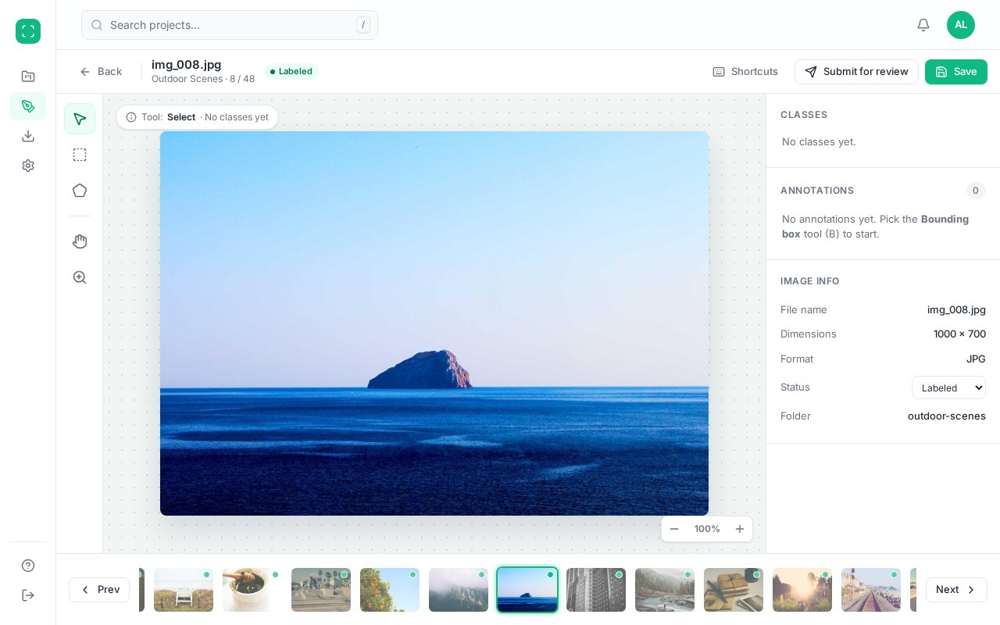
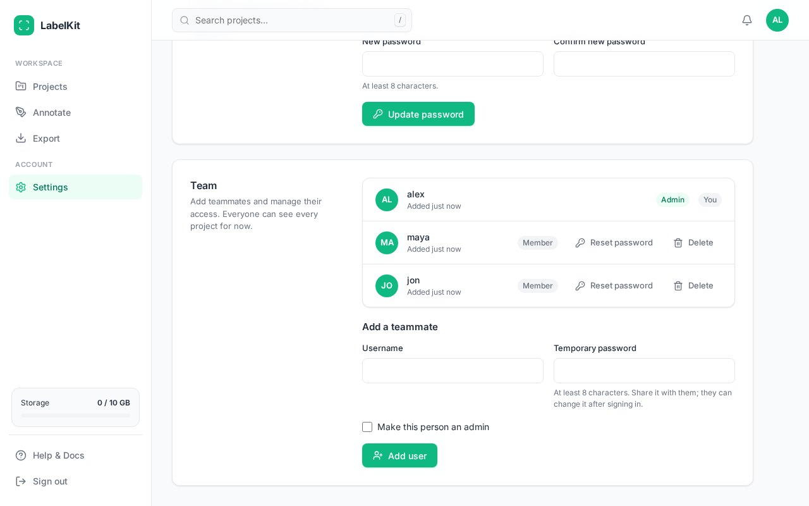

<div align="center">

# LabelKit

**A self-hosted image annotation tool for computer vision datasets.**<br>
Upload folders of images, track what is labeled, keep everything in one SQLite file.


</div>

> **Status:** early prototype. Dataset management and sign-in work today. Drawing annotations and exporting are next (see the [roadmap](#roadmap)).

## Features

- **Two ways to bring images in.** Upload a whole folder from the browser (sub-folders are kept), or import a folder that already sits on the server without copying it.
- **Per-image status.** `unlabeled`, `labeled` or `review`, with filters, progress bars and thumbnails.
- **Accounts.** Username and password, admins manage the team. Passwords are hashed with scrypt, failed logins are rate limited, sessions use HttpOnly cookies.
- **Nothing to install but Python.** One process and one SQLite file. No Docker, no Node, no build step; the UI is plain HTML, CSS and JavaScript.
- **Try it without the backend.** Open `index.html` for a clickable UI prototype (set `USE_DEMO_DATA = true` in `js/app.js` to fill it with sample data).

## Screenshots

<table>
  <tr>
    <td width="33%"><a href="docs/screenshots/project.jpg"></a></td>
    <td width="33%"><a href="docs/screenshots/annotate.jpg"></a></td>
    <td width="33%"><a href="docs/screenshots/team.jpg"></a></td>
  </tr>
  <tr>
    <td align="center"><sub>Project: images and status filters</sub></td>
    <td align="center"><sub>Annotate: image viewer</sub></td>
    <td align="center"><sub>Settings: team management</sub></td>
  </tr>
</table>

## Quick start

```bash
git clone https://github.com/meewoann/labeling-tool-ui.git
cd labeling-tool-ui
pip install -r backend/requirements.txt
python3 backend/app.py
```

Open <http://localhost:8000> and create the first account. It becomes the admin and can add teammates under **Settings → Team**.

To let other machines on a trusted network use it, run `python3 backend/app.py --lan`. It prints the address to share.

## Configuration

All optional, set as environment variables:

| Variable | Default | Purpose |
| --- | --- | --- |
| `LABELKIT_DB` | `backend/data/labelkit.db` | SQLite database file |
| `LABELKIT_UPLOAD_DIR` | `backend/data/uploads` | Where uploaded images are stored |
| `LABELKIT_IMPORT_ROOT` | *(unrestricted)* | Only allow "import from server path" inside this folder |

Images are stored as plain files and the database only keeps their paths and status. Back up both.

## Command line

```bash
python3 backend/cli.py project add "Outdoor Scenes"
python3 backend/cli.py import "Outdoor Scenes" /data/photos
python3 backend/cli.py stats "Outdoor Scenes"
python3 backend/cli.py user passwd alex      # reset a password, even if you are locked out
```

## Project layout

```
index.html … settings.html   one HTML file per page
css/style.css                all styles (colors are variables at the top)
js/app.js                    all front-end code
backend/
  app.py                     FastAPI app: API + serves the pages
  db.py, schema.sql          SQLite access and tables
  auth.py                    password hashing, sessions, login limiter
  cli.py                     command line tool
  test_*.py                  tests (also run on GitHub Actions)
```

Run the tests with `cd backend && python3 -m unittest -v`.

## Security notes

- There is no built-in HTTPS, so passwords travel unencrypted over plain HTTP. Put it behind HTTPS or a VPN before exposing it beyond a trusted network.
- Whoever opens the site first on a fresh database creates the admin account.
- Every account can see every project. There are no per-project permissions yet.

## Roadmap

- [ ] Classes and bounding box / polygon annotation
- [ ] Export to YOLO, COCO and Pascal VOC
- [ ] Per-project permissions
- [ ] S3 / MinIO image storage
- [ ] HTTPS and email sign-in

---

<sub>Tiếng Việt: [docs/README.vi.md](docs/README.vi.md)</sub>
