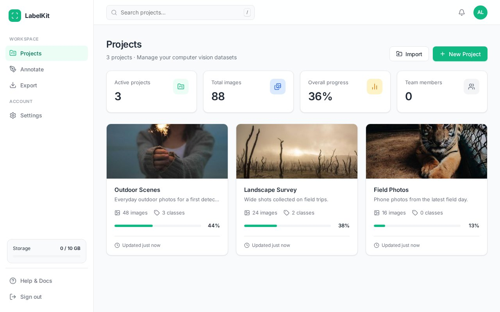
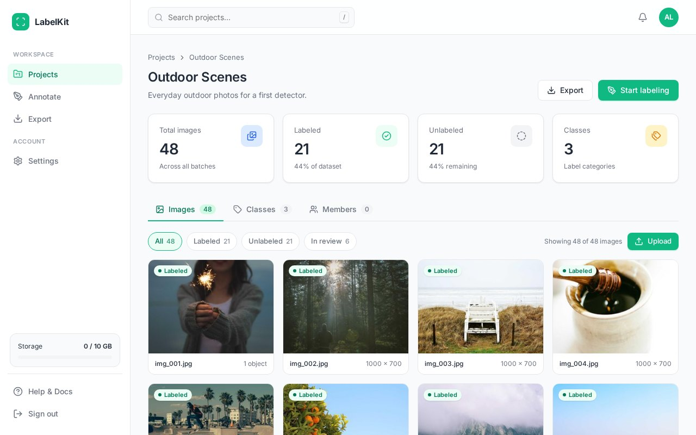
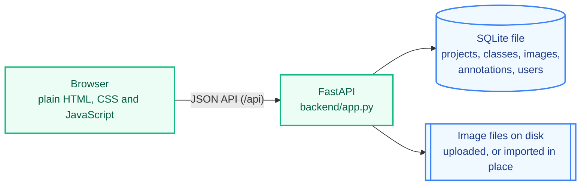

<div align="center">

# LabelKit

**A self-hosted image annotation tool for computer vision datasets.**<br>
Upload folders of images, draw boxes and polygons, and keep everything in one SQLite file.


</div>

> **Status:** early prototype. Datasets, classes, box and polygon annotation and sign-in work today. Exporting to YOLO / COCO is next (see the [roadmap](#roadmap)).
> A few parts of the interface are still placeholders: the Export page, the notification bell, the Import button, the storage meter and the Members tab.

## Features

- **Two ways to bring images in.** Upload a whole folder from the browser (sub-folders are kept), or import a folder that already sits on the server without copying it.
- **Boxes and polygons.** Draw bounding boxes and segmentation polygons, move and resize them, drag polygon points (double-click an edge to add one). Zoom with the wheel, pan with Space, undo and redo.
- **Classes per project.** Name, color and number-key shortcuts (1–9). Choosing a class while a shape is selected changes that shape's class.
- **Safe saving.** Coordinates are stored normalized (0–1), so they stay correct at any resolution. Changing image saves first, and if two people edit the same image the second save is refused instead of silently overwriting the first.
- **Per-image status.** `unlabeled`, `labeled` or `review` (the first annotation marks an image as labeled), with filters, progress bars and thumbnails.
- **Accounts.** Username and password, admins manage the team. Passwords are hashed with scrypt, failed logins are rate limited, sessions use HttpOnly cookies.
- **Nothing to install but Python.** One process and one SQLite file. No Node, no build step; the UI is plain HTML, CSS and JavaScript. A Docker setup is included if you prefer it.
- **Try it without the backend.** Open `frontend/index.html` for a clickable UI prototype (set `USE_DEMO_DATA = true` in `frontend/js/app.js` to fill it with sample data). Shapes can be drawn there but are only kept in memory.

## Screenshots

<table>
  <tr>
    <td width="33%"><a href="docs/screenshots/projects.jpg"></a></td>
    <td width="33%"><a href="docs/screenshots/project.jpg"></a></td>
    <td width="33%"><a href="docs/screenshots/classes.jpg"></a></td>
  </tr>
  <tr>
    <td align="center"><sub>Projects</sub></td>
    <td align="center"><sub>Images and status filters</sub></td>
    <td align="center"><sub>Classes with annotation counts</sub></td>
  </tr>
</table>

## Quick start

```bash
git clone https://github.com/meewoann/labeling-tool-ui.git
cd labeling-tool-ui
pip install -r backend/requirements.txt
python3 backend/app.py
```

Open <http://localhost:8000> and create the first account. It becomes the admin and can add teammates under **Settings → Team**.

To let other machines on a trusted network use it, run `python3 backend/app.py --lan`. It prints the address to share.

### With Docker

```bash
docker compose up -d --build
```

Then open <http://localhost:8000>. The database, uploaded images and thumbnails live in the `labelkit-data` volume, so they survive restarts and upgrades.

- **Share on your network:** in `docker-compose.yml` change `"127.0.0.1:8000:8000"` to `"8000:8000"`. By default it is only reachable from the machine itself.
- **Use images that are already on the host** without copying them: uncomment the read-only `/path/to/your/images:/images:ro` mount, then use *import from server path* with `/images/...` (and set `LABELKIT_IMPORT_ROOT: /images`).
- **Back up:** `docker run --rm -v labelkit-data:/data -v "$PWD":/backup alpine tar czf /backup/labelkit-data.tgz -C /data .`
- The container runs as a non-root user (uid 10001). If you replace the volume with a host folder, make it writable for that user: `sudo chown 10001 ./data`.
- GitHub Actions builds the image and smoke-tests it on every push to `main` and every pull request.

## Annotating

Open an image from a project (or use **Annotate** in the sidebar). Add classes first in the project's **Classes** tab.

| | |
| --- | --- |
| `B` then drag | draw a bounding box |
| `P` then click | draw a polygon; finish with a click on the first point, a double-click or `Enter`; `Backspace` removes the last point |
| `V` | select: drag a shape to move it, drag a handle to resize, double-click a polygon edge or point to add or delete a point |
| `1`–`9` | choose a class (or change the class of the selected shape) |
| `Delete` · `Esc` | delete the selected shape · deselect or cancel drawing |
| `Ctrl+Z` · `Ctrl+Shift+Z` | undo · redo |
| mouse wheel · `Space`+drag | zoom at the pointer · move the image |
| `←` `→` · `Ctrl+S` | previous / next image (saves first) · save |

Press `?` on the page for the full list.

## Configuration

All optional, set as environment variables:

| Variable | Default | Purpose |
| --- | --- | --- |
| `LABELKIT_DB` | `backend/data/labelkit.db` | SQLite database file |
| `LABELKIT_UPLOAD_DIR` | `backend/data/uploads` | Where uploaded images are stored |
| `LABELKIT_IMPORT_ROOT` | *(unrestricted)* | Only allow "import from server path" inside this folder |

Images are stored as plain files and the database only keeps their paths and status. Back up both. The Docker image sets the first two to `/data/...` for you.

## Command line

```bash
python3 backend/cli.py project add "Outdoor Scenes"
python3 backend/cli.py import "Outdoor Scenes" /data/photos
python3 backend/cli.py stats "Outdoor Scenes"
python3 backend/cli.py user passwd alex      # reset a password, even if you are locked out
```

## How it works



The browser only talks to the JSON API under `/api`. Every `/api` route requires a signed-in user except sign-in itself and the health check.

<details>
<summary>API overview</summary>

| Method and path | Who | What |
| --- | --- | --- |
| `GET /api/health` | anyone | is the backend running |
| `GET /api/auth/status` · `POST /api/auth/setup` · `POST /api/auth/login` · `POST /api/auth/logout` | anyone | first-run setup, sign in and out |
| `GET /api/auth/me` · `POST /api/auth/password` | signed in | who am I, change my password |
| `GET/POST /api/users` · `POST /api/users/{id}/password` · `DELETE /api/users/{id}` | admin | manage the team |
| `GET/POST /api/projects` · `GET /api/projects/{id}` | signed in | projects |
| `GET/POST /api/projects/{id}/classes` · `PATCH/DELETE /api/classes/{id}` | signed in | classes |
| `POST /api/projects/{id}/upload` · `/upload/finish` · `/import` | signed in | bring images in |
| `GET /api/projects/{id}/images` · `PATCH /api/images/{id}` | signed in | list images, change status |
| `GET /api/images/{id}/file` · `/thumb` | signed in | the image and its thumbnail |
| `GET/PUT /api/images/{id}/annotations` | signed in | read and save boxes and polygons (`PUT` needs the version you read; `409` if someone saved first) |

</details>

## Project layout

```
backend/
  app.py                 FastAPI app: the API, and serves the pages
  db.py, schema.sql      SQLite access and tables
  auth.py                password hashing, sessions, login limiter
  cli.py                 command line tool
  tests/                 unit and HTTP tests
frontend/                plain HTML, CSS and JavaScript, no build step
  index.html … 404.html  one file per page
  css/style.css          all styles (colors are variables at the top)
  js/app.js              pages, API calls
  js/annotator.js        the drawing engine (SVG): boxes, polygons, zoom, undo
  serve.py               tiny static server for the UI-only prototype
docs/                    screenshots and the Vietnamese README
.github/workflows/       CI: tests and a Docker build check
Dockerfile, docker-compose.yml
```

Run the tests with `cd backend && python3 -m unittest -v`.

## Security notes

- There is no built-in HTTPS, so passwords travel unencrypted over plain HTTP. Put it behind HTTPS or a VPN before exposing it beyond a trusted network.
- Whoever opens the site first on a fresh database creates the admin account.
- Every account can see every project. There are no per-project permissions yet.

## Roadmap

- [x] Classes, bounding boxes and polygons
- [ ] Export to YOLO, COCO and Pascal VOC
- [ ] Model-assisted pre-labeling
- [ ] Per-project permissions
- [ ] S3 / MinIO image storage
- [ ] HTTPS and email sign-in

---

<sub>Tiếng Việt: [docs/README.vi.md](docs/README.vi.md)</sub>
