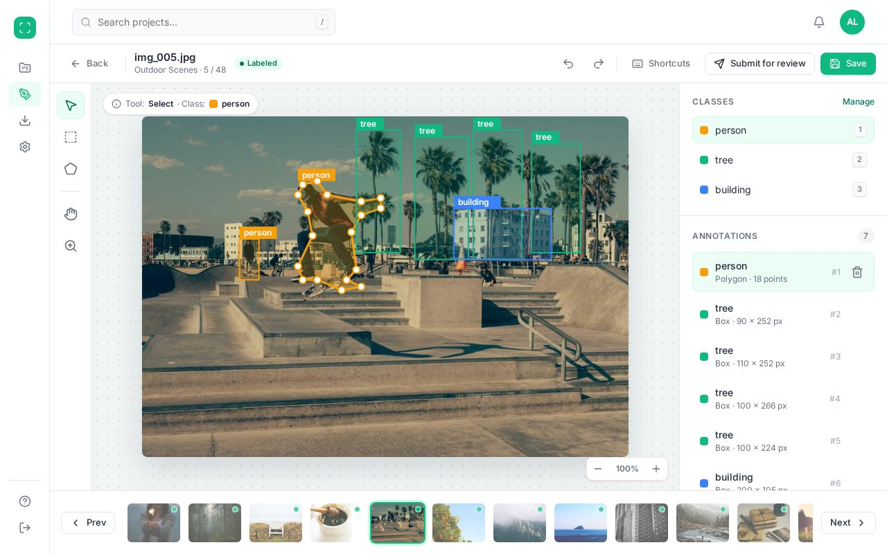
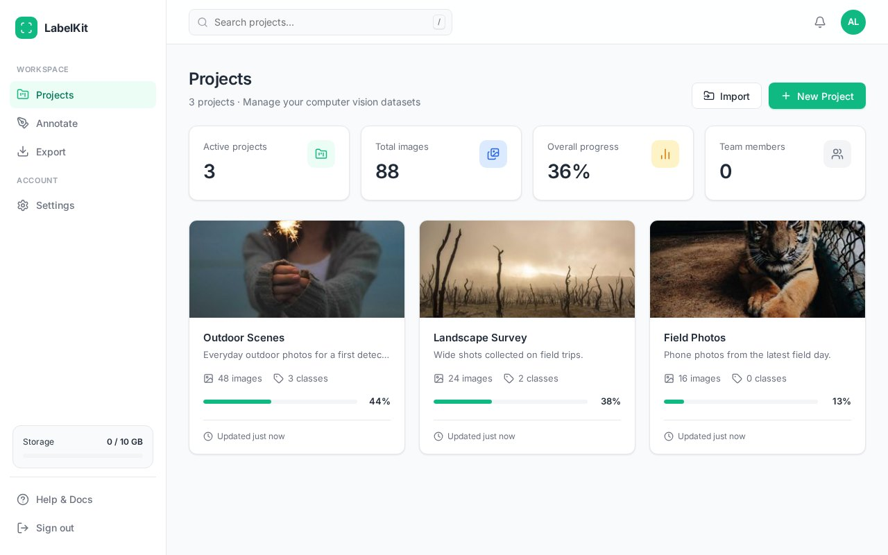
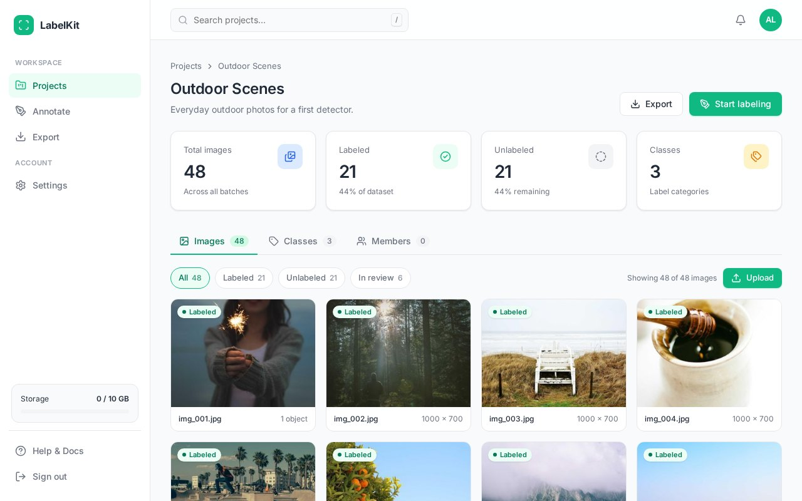
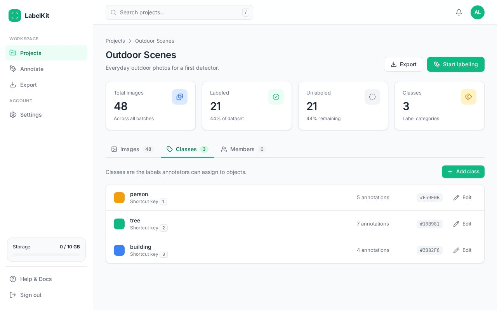
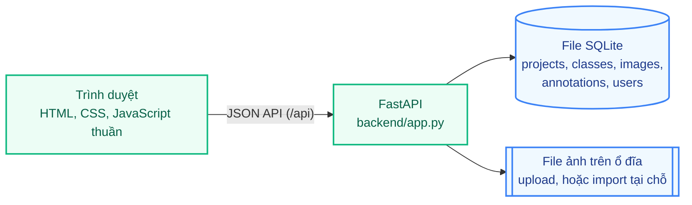

[English](../README.md) · **Tiếng Việt**

<div align="center">

# LabelKit

**Công cụ gán nhãn ảnh tự host cho dataset computer vision.**<br>
Upload folder ảnh, vẽ bounding box và polygon, lưu tất cả trong một file SQLite.




</div>

> **Trạng thái:** prototype giai đoạn đầu. Quản lý dataset, class, vẽ box và polygon, đăng nhập đã dùng được.
> Export ra YOLO / COCO là việc tiếp theo (xem [lộ trình](#lộ-trình)).
> Một vài phần giao diện vẫn chỉ là chỗ giữ chỗ: trang Export, chuông thông báo, nút Import, thanh dung lượng và tab Members.

## Tính năng

- **Hai cách đưa ảnh vào.** Upload cả folder từ trình duyệt (giữ nguyên folder con), hoặc import folder đã nằm sẵn trên máy chủ mà không copy.
- **Box và polygon.** Vẽ bounding box và polygon (segmentation), di chuyển, đổi kích thước, kéo từng đỉnh (bấm đúp vào cạnh để thêm đỉnh). Zoom bằng con lăn, dời ảnh bằng `Space`, có undo và redo.
- **Class theo từng project.** Có tên, màu và phím tắt 1–9. Chọn class khi đang chọn 1 hình thì đổi class của hình đó.
- **Lưu an toàn.** Tọa độ lưu dạng chuẩn hoá 0–1 nên đúng ở mọi độ phân giải. Chuyển ảnh sẽ tự lưu trước. Hai người cùng sửa một ảnh thì lần lưu sau bị từ chối, không ghi đè âm thầm lên người trước.
- **Trạng thái từng ảnh.** `unlabeled`, `labeled` hoặc `review` (có annotation đầu tiên thì ảnh tự thành labeled), kèm bộ lọc, thanh tiến độ và thumbnail.
- **Tài khoản.** Username và mật khẩu, admin quản lý team. Mật khẩu băm bằng scrypt, đăng nhập sai nhiều lần bị khoá tạm, phiên dùng cookie HttpOnly.
- **Kiểm tra GPU.** **Settings → This device** cho biết GPU của máy bạn đang dùng và trình duyệt có chạy được model AI trên đó không (WebGPU, WebGL hay chỉ render bằng phần mềm). Phát hiện ngay trong trình duyệt, không gửi gì lên server. Firefox cố ý giấu model card (nó báo một card chung chung như "GTX 980, or similar"), thẻ sẽ nói rõ điều đó thay vì đoán. Đây là bước chuẩn bị cho việc gán nhãn gợi ý bằng model.
- **Chỉ cần Python.** Một tiến trình và một file SQLite. Không Node, không bước build; giao diện là HTML, CSS, JavaScript thuần. Có sẵn cấu hình Docker nếu bạn muốn dùng.
- **Thử không cần backend.** Mở `frontend/index.html` để xem giao diện bấm được (đặt `USE_DEMO_DATA = true` trong `frontend/js/app.js` để có dữ liệu mẫu). Ở chế độ này vẽ được nhưng hình chỉ nằm trong bộ nhớ.

## Ảnh chụp màn hình

<table>
  <tr>
    <td width="33%"><a href="screenshots/projects.jpg"></a></td>
    <td width="33%"><a href="screenshots/project.jpg"></a></td>
    <td width="33%"><a href="screenshots/classes.jpg"></a></td>
  </tr>
  <tr>
    <td align="center"><sub>Danh sách project</sub></td>
    <td align="center"><sub>Ảnh và bộ lọc trạng thái</sub></td>
    <td align="center"><sub>Class kèm số annotation</sub></td>
  </tr>
</table>

## Chạy thử nhanh

```bash
git clone https://github.com/meewoann/labeling-tool-ui.git
cd labeling-tool-ui
pip install -r backend/requirements.txt
python3 backend/app.py
```

Mở http://localhost:8000 và tạo tài khoản đầu tiên. Tài khoản này là admin, thêm đồng đội ở **Settings → Team**.

Muốn máy khác trong mạng tin cậy dùng được thì chạy `python3 backend/app.py --lan`, terminal sẽ in ra địa chỉ để gửi cho họ.

### Chạy bằng Docker

```bash
docker compose up -d --build
```

Mở http://localhost:8000. Database, ảnh upload và thumbnail nằm trong volume `labelkit-data` nên không mất khi khởi động lại hay nâng cấp.

- **Cho cả mạng dùng:** trong `docker-compose.yml` sửa `"127.0.0.1:8000:8000"` thành `"8000:8000"`. Mặc định chỉ chính máy đó truy cập được. Chỉ làm ở mạng tin cậy (chưa có HTTPS).
- **Dùng ảnh có sẵn trên máy** mà không copy: bỏ comment dòng mount `/path/to/your/images:/images:ro`, rồi dùng "import từ đường dẫn trên máy chủ" với `/images/...` (và đặt `LABELKIT_IMPORT_ROOT: /images`).
- **Sao lưu:** `docker run --rm -v labelkit-data:/data -v "$PWD":/backup alpine tar czf /backup/labelkit-data.tgz -C /data .`
- Container chạy bằng user thường (uid 10001). Nếu thay volume bằng thư mục trên máy, cho user đó quyền ghi: `sudo chown 10001 ./data`.
- GitHub Actions tự build image và chạy thử mỗi lần push lên `main` và mỗi Pull Request.

## Cách gán nhãn

Mở một ảnh từ project (hoặc bấm **Annotate** ở sidebar). Tạo class trước ở tab **Classes** của project.

| Phím / thao tác | Việc làm |
| --- | --- |
| `B` rồi kéo chuột | vẽ bounding box |
| `P` rồi bấm từng điểm | vẽ polygon; kết thúc bằng bấm lại điểm đầu, bấm đúp hoặc `Enter`; `Backspace` bỏ điểm vừa đặt |
| `V` | chọn: kéo hình để di chuyển, kéo núm để đổi kích thước, bấm đúp cạnh / điểm của polygon để thêm / xoá điểm |
| `1`–`9` | chọn class (hoặc đổi class của hình đang chọn) |
| `Delete` · `Esc` | xoá hình đang chọn · bỏ chọn hoặc huỷ đang vẽ |
| `Ctrl+Z` · `Ctrl+Shift+Z` | undo · redo |
| con lăn chuột · `Space` + kéo | zoom tại con trỏ · dời ảnh |
| `←` `→` · `Ctrl+S` | ảnh trước / sau (tự lưu trước khi chuyển) · lưu |

Nhấn `?` trên trang để xem đủ danh sách.

## Cấu hình

Tất cả đều không bắt buộc, đặt bằng biến môi trường:

| Biến | Mặc định | Dùng để |
| --- | --- | --- |
| `LABELKIT_DB` | `backend/data/labelkit.db` | File database SQLite |
| `LABELKIT_UPLOAD_DIR` | `backend/data/uploads` | Nơi lưu ảnh upload |
| `LABELKIT_IMPORT_ROOT` | *(không giới hạn)* | Chỉ cho import từ đường dẫn nằm trong thư mục này |

Ảnh lưu thành file thường, database chỉ giữ đường dẫn và trạng thái, nên cần sao lưu cả hai. Image Docker đặt sẵn hai biến đầu về `/data/...`.
Import theo đường dẫn không copy ảnh, vì vậy đừng đổi tên hay di chuyển folder gốc sau khi import.

## Dòng lệnh

```bash
python3 backend/cli.py project add "Outdoor Scenes"
python3 backend/cli.py import "Outdoor Scenes" /data/photos
python3 backend/cli.py stats "Outdoor Scenes"
python3 backend/cli.py user passwd alex      # đặt lại mật khẩu, kể cả khi bạn bị khoá ngoài
```

## Cách hoạt động và cấu trúc thư mục



```
backend/
  app.py                 FastAPI: API và phục vụ các trang web
  db.py, schema.sql      truy cập SQLite và các bảng
  auth.py                băm mật khẩu, phiên đăng nhập, giới hạn đăng nhập sai
  cli.py                 công cụ dòng lệnh
  tests/                 test đơn vị và test API qua HTTP
frontend/                HTML, CSS, JavaScript thuần, không build
  index.html … 404.html  mỗi trang một file
  css/style.css          toàn bộ CSS (biến màu nằm ở đầu file)
  js/app.js              các trang và gọi API
  js/annotator.js        bộ vẽ (SVG): box, polygon, zoom, undo
  js/gpu.js              phát hiện GPU (WebGL / WebGPU)
  tests/                 test cho phần logic JavaScript thuần (chạy bằng Node)
  serve.py               server nhỏ chỉ phục vụ file tĩnh, cho bản chỉ có giao diện
docs/                    ảnh chụp màn hình và README này
.github/workflows/       CI: test backend, test frontend và kiểm tra build Docker
Dockerfile, docker-compose.yml
```

Chạy test: `cd backend && python3 -m unittest -v`, và `node frontend/tests/test_gpu.js` cho phần logic frontend.

Các trang: `index.html` (đăng nhập), `projects.html`, `project.html` (ảnh, class, thành viên), `label.html` (gán nhãn),
`export.html` (chỉ là giao diện mẫu), `settings.html` (mật khẩu, quản lý team), `404.html`.

## Dành cho người sửa frontend

- Muốn đổi màu chủ đạo: sửa các biến trong `:root` ở đầu `frontend/css/style.css`.
- `frontend/js/app.js` chia làm 5 phần: dữ liệu mẫu (`DEMO_*` và công tắc `USE_DEMO_DATA`), hàm tiện ích, tương tác chung
  (sidebar, modal, tab), code riêng từng trang (`initProjectsPage()`, `initLabelPage()`…), và phần khởi chạy đọc `<body data-page="...">`.
- `frontend/js/annotator.js` chỉ lo phần vẽ. Nó không biết gì về API: dữ liệu vào bằng `load()`, thay đổi báo ra qua callback.
- Một số quy ước trong HTML mà `app.js` dựa vào:
  - `data-open-modal="id"`: bấm để mở modal đó; `data-close-modal`: bấm để đóng (bấm ra ngoài hoặc `Esc` cũng đóng)
  - `data-tab="images"`: bấm để hiện panel `id="tab-images"` (link `project.html?id=1&tab=classes` mở sẵn đúng tab)
  - `data-toast="Nội dung"`: bấm để hiện thông báo nhỏ
  - `data-nav="projects"` trên link sidebar: để tô sáng mục đang ở

## Lưu ý bảo mật

- Chưa có HTTPS, nên mật khẩu đi qua mạng **không mã hoá** khi dùng HTTP. Hãy đặt sau HTTPS hoặc VPN trước khi mở ra ngoài mạng tin cậy.
- Ai mở web đầu tiên trên database mới sẽ tạo được tài khoản admin. Với `--lan`, hãy tự mở trang và tạo tài khoản ngay sau khi chạy lần đầu.
- Mọi tài khoản thấy mọi project, chưa có phân quyền theo project.
- Ô "import đường dẫn" cho phép người đã đăng nhập đăng ký bất kỳ folder ảnh nào trên máy chủ, nên đặt `LABELKIT_IMPORT_ROOT`.
- Server chỉ phục vụ các trang HTML, `css/` và `js/`; file database và code backend không tải được qua web. Trang `/docs` của FastAPI đã tắt.

## Lộ trình

- [x] Class, bounding box và polygon
- [ ] Export ra YOLO, COCO và Pascal VOC
- [ ] Gán nhãn gợi ý bằng model
- [ ] Phân quyền theo project
- [ ] Lưu ảnh trên S3 / MinIO
- [ ] HTTPS và đăng nhập bằng email
